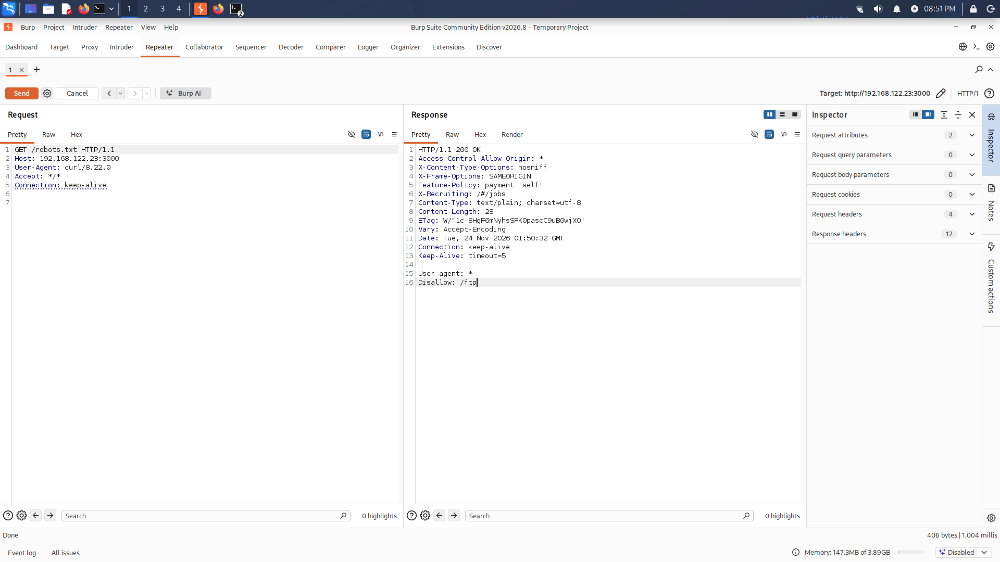
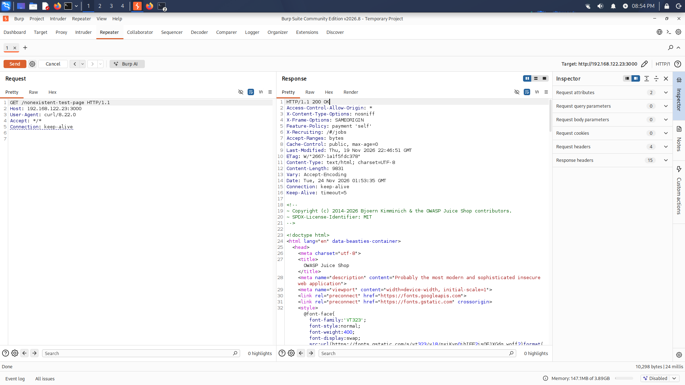
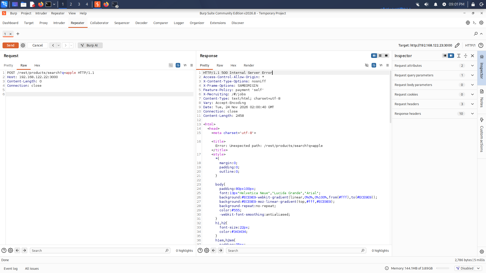

# Web Application Security Lab

## Overview

A self-hosted web application security lab designed to develop
practical skills in HTTP interception, API analysis, request
manipulation, and web application security testing using Burp
Suite and OWASP Juice Shop.

All testing is conducted within an authorized, locally controlled
virtualized environment.

## Lab Environment

| Component | Technology |
|---|---|
| Host Operating System | Kali Linux |
| Target Operating System | Ubuntu Server |
| Virtualization | KVM / QEMU |
| Containerization | Docker |
| Target Application | OWASP Juice Shop |
| Security Testing | Burp Suite Community Edition |
| Network Privacy | Mullvad VPN |
| Remote Administration | SSH |
| HTTP Client | curl |

## Network Architecture

```text
Kali Linux Host
    |
    |-- Burp Suite Proxy (127.0.0.1:8080)
    |-- curl
    |-- Mullvad VPN
    |
    |-- KVM Virtual Network
            |
            Ubuntu Server (192.168.122.22)
                |
                Docker
                    |
                    OWASP Juice Shop (TCP 3000)
```

## Implementation

### 1. Network Configuration

- Established connectivity between Kali Linux and Ubuntu Server.
- Configured Mullvad LAN sharing to permit local lab communication.
- Verified connectivity through ICMP and SSH.
- Maintained an active VPN connection during security testing.

### 2. Application Deployment

Installed and enabled Docker on Ubuntu Server:

```bash
sudo apt install -y docker.io
sudo systemctl enable --now docker
```

Deployed OWASP Juice Shop:

```bash
sudo docker run -d \
  --name juice-shop \
  --restart unless-stopped \
  -p 192.168.122.22:3000:3000 \
  bkimminich/juice-shop
```

Verified application availability:

```bash
curl -I http://192.168.122.22:3000
```

### 3. HTTP Traffic Interception

Configured Burp Suite as an HTTP interception proxy and routed
requests through its local proxy listener.

```bash
curl -x http://127.0.0.1:8080 \
  http://192.168.122.22:3000
```

Successfully intercepted, inspected, and forwarded HTTP traffic
between the testing host and the target application.

### 4. Request Replay and API Analysis

Used Burp Repeater to manually replay HTTP requests and inspect
server responses.

Analyzed:

- HTTP request methods and headers
- HTTP response status codes
- Response content types
- Application security headers
- JSON API responses
- Structured product data

Successfully received HTTP 200 OK responses from the target
application and inspected structured API data.

## Results

- Successfully deployed a containerized web application.
- Established communication across a virtualized network.
- Intercepted and forwarded HTTP traffic using Burp Proxy.
- Replayed HTTP requests using Burp Repeater.
- Analyzed HTTP headers and JSON API responses.
- Established a reproducible environment for future security testing.

## Screenshots

### HTTP Interception



### Request Replay



### API Response Analysis



## Skills Demonstrated

- Linux system administration
- Network configuration and troubleshooting
- Virtualization and containerization
- HTTP protocol analysis
- Web application security fundamentals
- API reconnaissance
- Proxy configuration
- Technical documentation

## Future Development

- SQL injection testing
- Cross-site scripting (XSS) testing
- Authentication and authorization analysis
- Access control testing
- Vulnerability documentation and remediation recommendations

## Ethical Use

This project is intended exclusively for educational purposes.
All security testing is performed against an intentionally
vulnerable application within an authorized, locally controlled
lab environment.

## References

- https://owasp.org/www-project-juice-shop/
- https://portswigger.net/burp
- https://docs.docker.com/

## Phase 2: Authentication and Security Analysis

### Authentication Testing

Conducted six authentication input tests using Burp
Suite Repeater, comparing server responses and evaluating
input validation and exception handling.

### Security Analysis

- Analyzed HTTP security headers.
- Identified JWT-based authentication using RS256.
- Examined authentication response structures.
- Identified sensitive data within the JWT payload.
- Documented security observations and recommendations.

### Detailed Findings

- [Authentication Testing](findings/authentication-testing.md)
- [Security Analysis](findings/security-analysis.md)

### Additional Evidence

- [Baseline Authentication](screenshots/04-baseline-authentication.png)
- [Malformed Input](screenshots/05-malformed-input.png)
- [Boolean Test](screenshots/06-boolean-test.png)
- [Modified Email](screenshots/07-modified-email.png)
- [Empty Email](screenshots/08-empty-email.png)
- [Empty Password](screenshots/09-empty-password.png)
- [JWT Authentication](screenshots/10-jwt-authentication.png)
